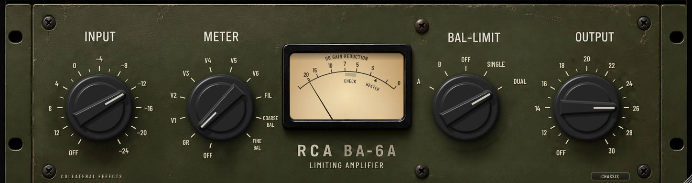

# RCA BA-6A — emulazione del limiting amplifier (v0.9.1) · Collateral Effects

Plugin VST3 / AU / Standalone (C++17, JUCE 8.0.16-security, CMake) che emula il limitatore
a valvole **RCA BA-6A (MI-11225)**. Tutti i comandi, le scale e le costanti derivano dal
manuale RCA IB-18-2035-2, dallo schema di Fig. 8 e dallo schema corretto del 2004 (cartella `docs/references/`).



## Comandi (come sull'hardware)

| Comando | Posizioni | Significato |
|---|---|---|
| **INPUT** | OFF, +14 … −24 (20 scatti da 2 dB) | livello d'ingresso in dBm che porta al **limite di intervento** (attenuatore R1 sulle griglie delle 6SK7) |
| **METER** | OFF, GR, V1…V6, FIL, COARSE BAL, FINE BAL | strumento: riduzione di guadagno, correnti catodiche, tensione di accensione, bilanciamento |
| **BAL-LIMIT** | A, B, OFF, SINGLE, DUAL | A/B: bilanciamento delle 6SK7 (uscita staccata dalla linea, 60 Hz sulle griglie); OFF: nessuna limitazione (~54 dB di guadagno); SINGLE: 0,6 ms / 0,33 s; DUAL: in più R37/C18, 0,9 s / 2 s |
| **OUTPUT** | OFF, 11 … 30 (20 scatti da 1 dB) | livello d'uscita in dBm al limite di intervento (attenuatore a T ponte R36) |

Strumento **DB GAIN REDUCTION** (20-15-10-7-5-3-0, banda CHECK, tacca HEATER), con ago a riposo a sinistra,
fondo scala = 0 dB di riduzione e balistica di un galvanometro d'Arsonval. Le lampade si spengono con l'alimentazione.

**CHASSIS** apre il pannello incernierato con i sette comandi interni: ON-OFF, BALANCE A (catodo),
BALANCE B (griglia schermo), ZERO ADJ., FINE OUTPUT (reostato R35), HUM ADJ. (agisce solo sull'alimentazione di
un preamplificatore esterno, quindi non ha effetto sull'audio, come sull'originale) e HEATER VOLTAGE ADJ.
Si possono eseguire le procedure del manuale (bilanciamento A/B su COARSE/FINE BAL, azzeramento, verifica
dei filamenti) con le manopole frontali sempre raggiungibili. Ci sono anche due opzioni del plugin, segnate come tali:
STEREO (LINK: due unità con le griglie di controllo collegate; DUAL: due unità indipendenti), NOISE + HUM (fruscio e ronzio residui a −54 dBm, come da specifica) e MAINS (rete a 60 o 50 c/s: frequenza del ronzio e del segnale di bilanciamento; l'originale americano è a 60).

### Livelli digitali

L'hardware lavora a livello di linea broadcast (+29,5 dBm in uscita al limite). Il plugin usa due riferimenti fissi:

- ingresso: **0 dBm = −18 dBFS** (EBU R68). Con INPUT su "0" la limitazione parte da −18 dBFS; con "−24" da −42 dBFS; con "+14" da −4 dBFS;
- uscita: **+36 dBm = 0 dBFS**. Con OUTPUT su "18" il livello al limite è −18 dBFS: guadagno unitario se INPUT è su "0".

Valori predefiniti: INPUT 0, OUTPUT 18, BAL-LIMIT OFF, METER GR.

## Compilazione con GitHub Actions

Carica il contenuto di questa cartella nella radice di `mermau/RCABA6A` (compresa `.github/workflows/build-macos.yml`).
Il workflow (macOS 15, arm64, target 11.0):

1. compila VST3, AU, Standalone e i test;
2. esegue i test DSP contro i dati RCA e i test d'integrazione del plugin, poi pubblica gli screenshot della GUI generati dai test (artifact `rcaba6a-gui-snapshots`);
3. firma ad hoc, verifica l'AU con `auval` e il VST3 con `pluginval` (strictness 10);
4. pubblica tre artifact zip: VST3, AU e Standalone.

### Aggiornare il repository dalla v0.8.1

Sostituisci tutto il contenuto del repository con questa cartella. Questi file della v0.8.1 vanno **cancellati**:
`README-PATCH.md`, `PATCH-FILE-PER-FILE.md`, `SOURCE_MANIFEST_SHA256.txt`, `assets/preview.png`,
`assets/panel_clean_preview.png`, `assets/output_scale_master.png`, `assets/output_scale_manifest.json`,
`assets/generate_output_scale.py`, `Tests/ControlCalibrationTests.cpp`, `Tests/GUIAssetTests.cpp`,
`Tests/StaticBezelTests.py`, `Tests/OutputScaleTests.py`, `docs/VALIDATION.md`, `docs/REVIEW_FOR_CLAUDE.md`,
`docs/LOCAL_TEST_RESULTS.txt`.

## Installazione (Apple Silicon)

```bash
sudo cp -R rcaba6a.vst3 /Library/Audio/Plug-Ins/VST3/
sudo cp -R rcaba6a.component /Library/Audio/Plug-Ins/Components/
sudo xattr -cr /Library/Audio/Plug-Ins/VST3/rcaba6a.vst3 /Library/Audio/Plug-Ins/Components/rcaba6a.component
```

Dalla v0.9.1 il plugin compare sotto **Collateral Effects** (codice produttore `Clfx`, bundle `com.collateraleffects.rcaba6a`).
L'host lo vede come un plugin nuovo: nei progetti creati con le versioni precedenti va reinserito. Lo stato salvato
(il chunk del plugin) resta compatibile, quindi si possono copiare le impostazioni con i preset del DAW.
Prima di installare la nuova versione cancella le vecchie copie `rcaba6a.vst3` e `rcaba6a.component`.

Le sessioni salvate con le v0.8.x vengono convertite automaticamente: le vecchie scale sono mappate sullo scatto reale
con la stessa attenuazione. Le automazioni registrate sui vecchi parametri `input`, `output`, `mode` e `meter` vanno invece
ricreate, perché il loro intervallo non corrispondeva all'hardware.

## Struttura

- `Source/DSP/BA6AEngine.*`: modello del circuito (C++ puro, testabile senza JUCE)
- `Source/DSP/ControlCalibration.h`: tabelle di comandi, angoli, scala dello strumento e calibrazione, usate da DSP, GUI e test
- `Source/PluginProcessor.*`: parametri, oversampling 2× a 44,1/48 kHz con latenza dichiarata, bypass allineato, migrazione degli stati
- `Source/PluginEditor.*`: GUI (fotografia del pannello ripulita, legende vettoriali, manopole renderizzate, strumento, cassetto chassis)
- `assets/tools/generate_panel.py`, `assets/tools/render_knobs.py`: rigenerano `panel_clean.jpg` e `knob_strip.png` a partire da `panel.jpg`
- `Tests/EngineTests.cpp`: 88 verifiche contro Technical Data, Fig. 4, Fig. 5, Fig. 6/7 e la tabella dello strumento
- `Tests/PluginTests.cpp`: processor, latenza, mono/stereo, migrazione degli stati, editor e screenshot
- `docs/AUDIT_v0.9.md`: errori trovati nella v0.8.1 e correzioni
- `docs/CIRCUIT_ANALYSIS.md`: derivazione del modello e limiti dichiarati
- `docs/TEST_RESULTS.txt`: risultati dei test

Font: Barlow Condensed (SIL Open Font License, `assets/fonts/OFL-BarlowCondensed.txt`).
